# Deferred issues

Reported on 2026-10-28 against the installed Flatpak commit `78703b236aae2da4de6499047a4c32db3575455e6a3fb064e5f9821a347a9aec`.

These issues are recorded for a future session. The request was explicitly to document them without fixing them. Do not implement, rebuild, install or restart the app for these issues until further instruction.

## WC-001. Active Data and Leftover Data button sizing

The filter buttons look oversized and have excess horizontal space around their labels. The selected-state highlight and checkmark are present; the remaining complaint concerns the controls' proportions.

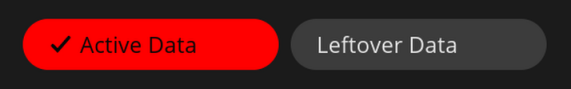

To reproduce later:

1. Open the installed Warehouse COSMIC Flatpak and select User Data.
2. Switch between Active Data and Leftover Data.
3. Compare the buttons' widths, height and padding with their labels and nearby controls at normal and maximized window sizes.

Expected: compact, consistently proportioned controls while keeping the selected filter clear. The exact revised sizing has not been chosen.

Start with `src/app.rs::data_view`, which currently gives both buttons a fixed logical width of 160. This is an investigation lead, not a confirmed diagnosis. Preserve the accent background and checkmark unless a later request changes that requirement.

The supplied screenshot is the evidence for this report. Its [provenance and SHA-256](assets/user-reports/2026-10-28/data-filter-sizing.json) are saved beside it. Verify the preserved image from the repository root with:

```sh
sha256sum docs/assets/user-reports/2026-10-28/data-filter-sizing.png
```

Existing GUI checks verify filter switching and a visible background change. They do not establish that the button proportions are satisfactory. Future verification should inspect both selected states in dark and light themes and add a meaningful layout check to `verification/check-ui-cli-flatpak.py`.

## WC-002. Dropping a .flatpak file does not open installation review

Dragging a `.flatpak` file onto Warehouse COSMIC does not show the install UI. The reference Warehouse app opens its install review when a package is dropped, just as when the file is opened with Warehouse. This behavior is reported here and was not independently reproduced in this documentation-only session.

To reproduce later:

1. Open the installed Warehouse COSMIC Flatpak on native Wayland.
2. Drag a valid local `.flatpak` file from the file manager onto the existing app window and release it.
3. Compare the result with opening the same file through the app's desktop launcher and with dropping it onto the reference Warehouse app.

Expected: present the existing window and show the same compact install review used for file opening, including the filename and installation choice. A drop must not create another app instance or begin installation without confirmation. Cancel must leave installed packages unchanged.

Start with the native file-drop handling and route accepted files through the existing `Message::FilesPicked` / `App::review_install_files` path in `src/app.rs`. Check native file URI/MIME handling and access to the dropped file inside the Flatpak; the cause has not been diagnosed. `App::dbus_activation` and file arguments in `src/main.rs` already provide comparison paths for opening files.

The [feature mapping](parity.md) already lists drag-and-drop installation as unimplemented. Existing desktop file-open and `ui open` tests do not exercise a real native drag-and-drop operation. Future verification must include an actual file-manager drop into the installed Flatpak, review cancellation, and confirmation that no extra window or installation was created. Include a filename containing spaces when checking file URI handling.

## WC-003. Overlapping dropdown item highlights

The installation-scope and remote dropdown menus have rounded item backgrounds that appear to touch or overlap adjacent rows. The supplied captures show `system` and selected `user` in the scope menu, and selected Fedora alongside hovered Flathub and Parsec in the remote menu.

The same visual problem is also reported in Settings → Appearance → Theme: the selected Match desktop background and hovered Dark background run into one another. This adds a third affected popup; a shared widget cause remains an investigation lead rather than a confirmed diagnosis.

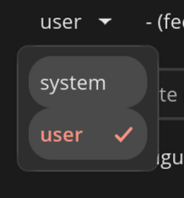

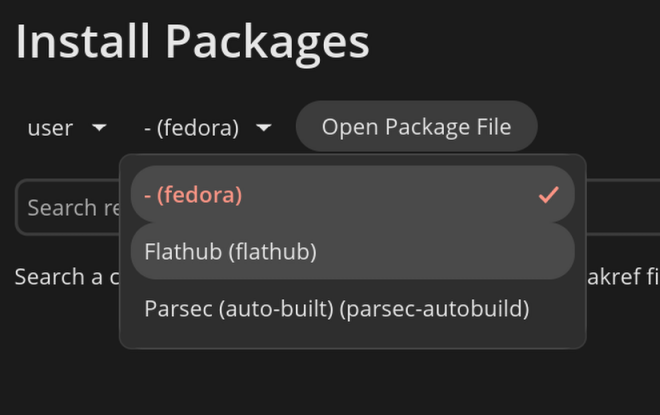

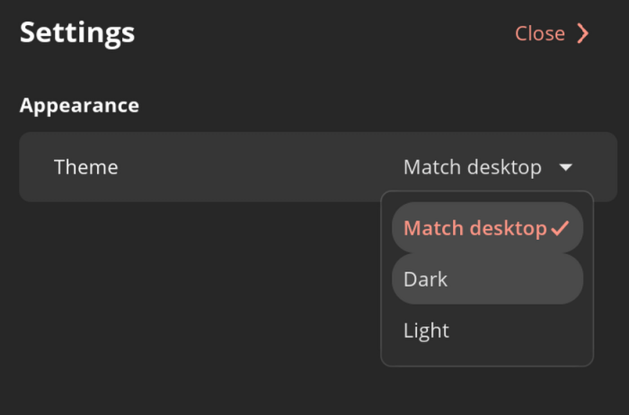

To reproduce later:

1. Open Install Packages in the installed Flatpak.
2. Open the installation dropdown and hover a different row while keeping `user` selected.
3. Open the remote dropdown and hover Flathub while another remote is selected.
4. Inspect item height, spacing and selected/hovered highlight bounds inside each popup.
5. Open Settings → Appearance → Theme with Match desktop selected, then hover Dark and inspect the separation between their backgrounds.

Expected: distinct, readable menu rows whose selection and hover backgrounds stay within their own rows, with consistent spacing. Preserve clear selection and hover feedback.

Start with the two `widget::dropdown` controls in `src/app.rs::install_view`, the Theme dropdown in `src/app.rs::context_drawer`, and the shared libcosmic dropdown layout/style. The cause has not been diagnosed, and these popups were not tested live in this documentation-only session. Future checks should open all three actual popups, hover adjacent items, and inspect both themes and normal/narrow window sizes. A screenshot of closed controls or a semantic selection change alone does not verify popup layout.

The original images and [scope-menu provenance](assets/user-reports/2026-10-28/install-scope-menu-overlap.json), [remote-menu provenance](assets/user-reports/2026-10-28/install-remote-menu-overlap.json) and [theme-menu provenance](assets/user-reports/2026-10-28/settings-theme-menu-overlap.json) are preserved. Verify their hashes from the repository root with:

```sh
sha256sum docs/assets/user-reports/2026-10-28/*-menu-overlap.png
```

## WC-004. Uninstall confirmation should follow Warehouse's clearer design

The supplied reference is clearer than the current generic confirmation. Warehouse names the app, explains removal in plain language, puts the Keep/Trash app-data choice inside the dialog, and labels the final action Uninstall. Warehouse COSMIC instead shows a raw Flatpak command, a separate "Keep app data" summary and a generic Continue button.

Reference Warehouse:

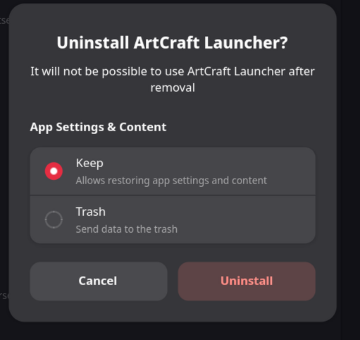

Current Warehouse COSMIC:

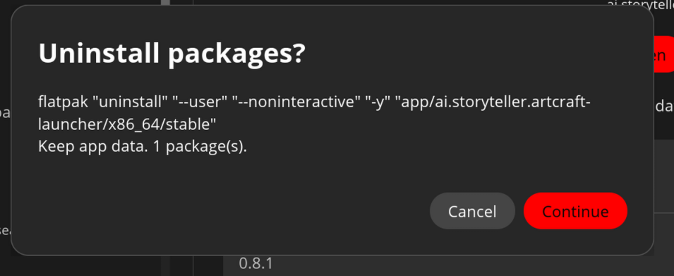

Suggested direction from the reference, for a future design pass:

- Use an app-specific title such as "Uninstall ArtCraft Launcher?" and a short explanation of the consequence.
- Put App Settings & Content choices in the confirmation: Keep, selected by default, and Trash, with a short explanation for each.
- Use explicit Cancel and Uninstall actions with suitable destructive styling.
- Keep the dialog compact and readable. Retain command details in the CLI plans and operation reports.

The exact revised layout has not been chosen. Preserve the existing shared-app-data warning and desktop Trash behavior when offering Trash; it must not become permanent deletion.

To reproduce later, select an installed app and press Uninstall, then inspect the confirmation without continuing. Compare its title, explanation, data choice, button labels and spacing with the supplied reference. Start with `src/app.rs::package_detail`, its `uninstall_data` checkbox, `Dialog::Confirm`, and `Operation::Uninstall` / `Operation::description` in `src/backend.rs`. Confirm the current function boundaries before editing.

Future verification should cover Keep as the default, switching Keep/Trash, cancellation without changes, long app names, both themes, and batch-uninstall wording. Applied uninstall/data tests must use disposable fixture packages rather than ArtCraft Launcher or another real installed app. Preserve installation-scope handling, CLI apply guards and system authorization. Backend command tests alone do not verify confirmation usability.

The supplied screenshots are the evidence; no uninstall was attempted in this documentation-only session. Their [reference provenance](assets/user-reports/2026-10-28/uninstall-warehouse-reference.json) and [current-UI provenance](assets/user-reports/2026-10-28/uninstall-cosmic-current.json) include hashes. Verify them from the repository root with:

```sh
sha256sum docs/assets/user-reports/2026-10-28/uninstall-*.png
```

## WC-005. Install Packages needs Warehouse's clearer page organization

The preferred reference separates choosing a remote, adding local files and reviewing pending packages. The current page presents installation/remote dropdowns, an Open Package File button and a wide search field at the top, with little structure in the remaining space. Its pending-package section appears only when the queue is nonempty.

Reference Warehouse:

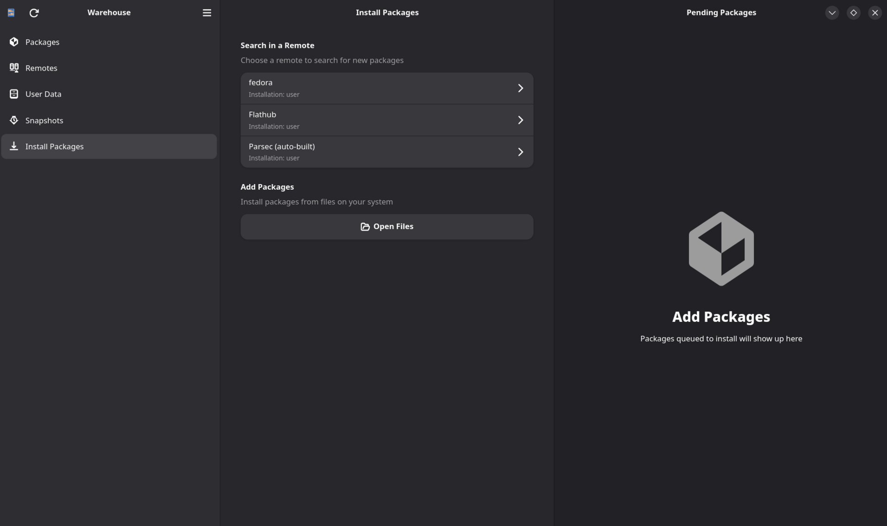

Current Warehouse COSMIC:

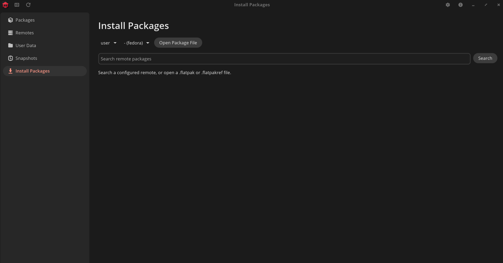

Suggested direction from the reference, for a future design pass:

- A Search in a Remote section with a short explanation and grouped remote rows. Show a readable remote title, its installation scope and a clear navigation affordance. The reference lists Fedora, Flathub and Parsec as individual choices.
- A separate Add Packages section explaining local file installation, with a prominent Open Files control.
- A distinct Pending Packages pane that remains understandable when empty, with an icon and a short explanation of where queued packages appear.
- A bounded content column, clear headings and consistent spacing. Use the available width deliberately; adapt the pane arrangement at narrow widths. Avoid an oversized repeated page heading competing with the title bar.

The exact native libcosmic layout has not been chosen. Keep remote and installation scope explicit throughout search, queue and review. Use readable remote names rather than the `- (fedora)` placeholder visible in the current capture.

To reproduce later, open Install Packages with an empty queue in the installed Flatpak and compare the information hierarchy with the supplied reference. Inspect remote selection, local-file entry and the empty pending state, then repeat with a queued disposable package. Do not confirm an installation on a real app as part of a layout check.

Start with `src/app.rs::install_view`, `install_remotes`, the queue rendering and their selection/search handlers. The existing `src/remotes.rs` title fallback is a useful comparison for the placeholder title. This is a design report, not a diagnosed backend failure. Coordinate with WC-002 for native file drops and WC-003 for dropdown overlap; a page redesign alone does not verify either behavior.

Future checks should cover empty and populated queues, remote titles and scope labels, switching remotes/installations without misrouting queued references, local-file review/cancellation, search results, and normal/narrow/maximized layouts in both themes. Inspect the actual rendered page and extend GUI CLI coverage for any new controls. Preserve backend apply guards and install confirmation.

Both screenshots were supplied as evidence; no page interaction or install was performed in this documentation-only session. Their [reference provenance](assets/user-reports/2026-10-28/install-page-warehouse-reference.json) and [current-UI provenance](assets/user-reports/2026-10-28/install-page-cosmic-current.json) include hashes. Verify them from the repository root with:

```sh
sha256sum docs/assets/user-reports/2026-10-28/install-page-*.png
```

## WC-006. Snapshots page and creation dialog need clearer organization

The preferred Warehouse reference has a centered empty state with a prominent New Snapshot action directly beneath its explanation. Its creation dialog provides a snapshot-name field and a searchable, scrollable app list with icons, names, IDs and selection indicators, plus Select All, a selected count, Cancel and Create.

Reference Warehouse empty state:

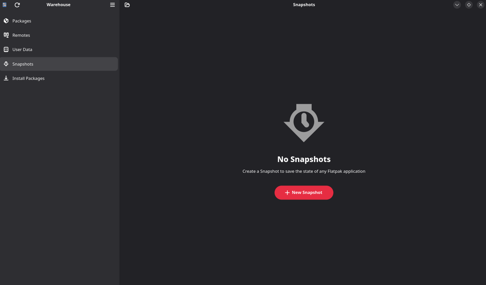

Reference Warehouse creation dialog:

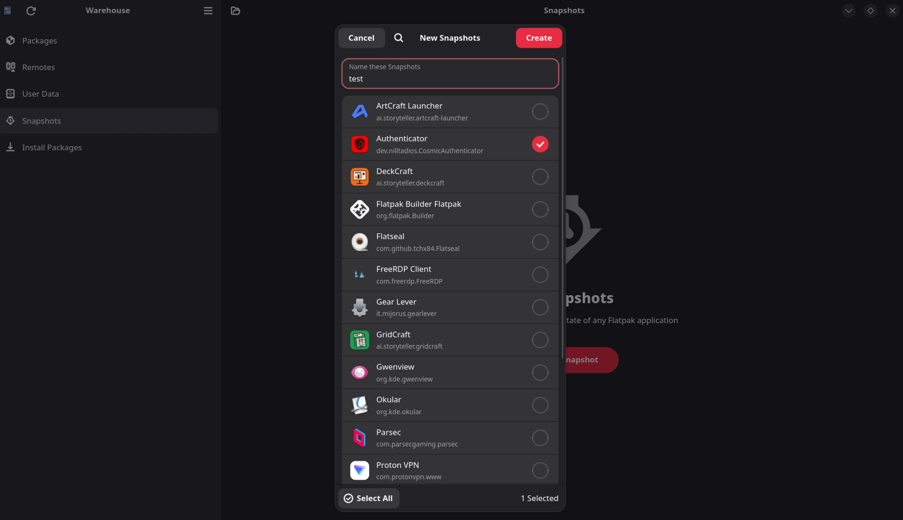

Current Warehouse COSMIC empty state:

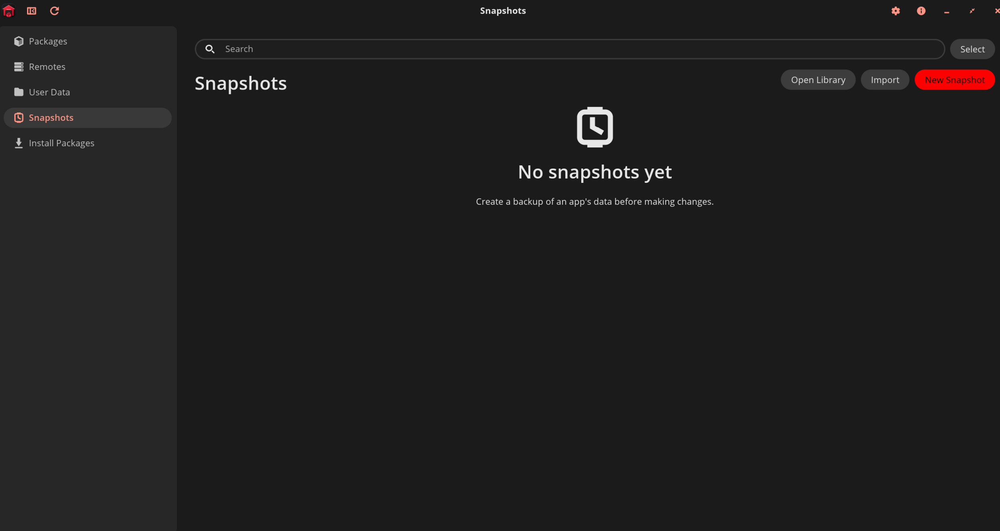

The current page puts search/selection controls, a repeated Snapshots heading and Open Library/Import/New Snapshot actions across the top. Its empty-state message sits higher in the content area, separated from the New Snapshot action. Source inspection also shows that its current creation dialog asks for application IDs or comma-separated IDs and a snapshot name; no screenshot of that current dialog was supplied here.

Suggested direction for a future design pass:

- Center the empty-state icon, title, explanation and New Snapshot action together in the available content area.
- Reduce empty-state toolbar clutter and repeated headings while keeping Open Library and Import discoverable as secondary actions.
- Offer visual app selection with icons, names and IDs, search, clear selection markers, Select All and a selected count.
- Keep the name field and Cancel/Create actions easy to find as the app list scrolls. Enable creation only when the selection and required inputs are valid.

The exact native libcosmic layout has not been chosen. Preserve multi-app snapshots, snapshotting eligible leftover data, import/export and existing-library behavior. Keep the warning to close affected apps for a consistent backup; do not automatically terminate them. Preserve archive validation, recovery behavior and the manager's own snapshot-library exclusion.

To reproduce later, open Snapshots with an empty library, compare the action placement with the reference, then open New Snapshot and inspect the creation workflow without creating a backup of a real app. Start with `src/app.rs::snapshots_view`, `Dialog::NewSnapshot`, the `Message::NewSnapshot` / `BatchSnapshot` / `SnapshotFor` handlers and their selection state. The screenshot comparison describes a UI preference; no backend snapshot failure is reported here.

Future checks should cover an empty library, a populated library and an empty search result separately; name entry; searching by app name/ID; single/multiple selection; Select All; selection counts; cancellation without writes; and normal/narrow/maximized layouts in both themes. Extend GUI CLI coverage for the visible selection controls. Applied creation/restore tests must use disposable fixture data, with existing safety checks retained.

All three screenshots were supplied as evidence. Their [empty-state reference provenance](assets/user-reports/2026-10-28/snapshots-empty-warehouse-reference.json), [creation-dialog reference provenance](assets/user-reports/2026-10-28/snapshots-create-warehouse-reference.json) and [current-UI provenance](assets/user-reports/2026-10-28/snapshots-empty-cosmic-current.json) include hashes. No snapshot was created, restored or removed in this documentation-only session. Verify the preserved images from the repository root with:

```sh
sha256sum docs/assets/user-reports/2026-10-28/snapshots-*.png
```

## Scope of this record

Only documentation and the supplied screenshots were saved. No application source, package, settings or running window was changed. No build or GUI test was run for these reports. Launch and test the Flatpak in a later session; close only test-created windows and preserve any window in use.
